<div align="center">
  
  <br>
  <small><i>the logo was drawn by mennymenmen she very cool gooby this gooby that</i></small>
  <br><br>
  <p><strong>Edith Mod Loader for Haydee</strong></p>
  <p>
    <a href="https://github.com/iluxz/EML"></a>
    <a href="https://github.com/iluxz/EML/releases"></a>
    <a href="LICENSE"></a>
  </p>
</div>

---

# EML - Edith Mod Loader

Mod loader and tools for **Haydee** (the game) and its map editor **Edith** (or engine, i geniunely dont know i cant differentiate the two), built by reverse engineering `edith.exe` and `haydee.dll`.

## Features

- **DLL injection** — injects mod DLLs into edith.exe at runtime
- **Auto-backup hook** — backs up files before saving (prevents crash corruption)
- **90-degree rotation snap** — patches rotation step from 15° to 90° (CSGs + slight snap on meshes)
- **Crash recovery** — auto-restores corrupted .edith files after a crash
- **Custom packer** — create .pack files from folder structures
- **Audio converter** — convert .ogg/.mp3 to Haydee .sound format
- **Haydee format reference** — documented file formats (.edith, .mesh, .pack, .sound, .scene, .game, etc.)

## Installation

```bash
python eml_installer.py
```

The installer will:
1. Find your Haydee install
2. Create a `Mods\` folder
3. Copy injector + EML_core.dll
4. Write safety scripts (auto_backup, crash_recovery)
5. Create a launcher bat

## Usage

1. Run `launch_edith_modded.bat` in your Haydee folder
2. Or manually: start edith.exe, then run `injector.exe edith.exe <mod.dll>`

Place additional mod DLLs in `Haydee\Mods\`.

## Mod Usage

Mods are DLL files placed in the `Haydee\Mods\` folder. EML injects all `.dll` files found there on startup.

To create your own mod:
1. Write a C/C++ DLL that hooks functions in edith.exe or haydee.dll
2. Use `injector.exe edith.exe your_mod.dll` to test
3. Place the DLL in `Haydee\Mods\` for auto-loading

See `modloader/payload.c` for an example of how hooks work.

## Tools

| Tool | Description |
|------|-------------|
| `eml_installer.py` | One-click installer |
| `injector.exe` | DLL injector for edith.exe |
| `auto_backup.py` | Watches .edith files, backs up on change |
| `crash_recovery.py` | Auto-restores corrupted files after crash |
| `packer.py` | Creates .pack files from folders |
| `convert_all.py` | Batch converts audio to Haydee format |

## Documentation

- [Haydee Format Reference](docs/HAYDEE_REFERENCE.md) — file formats, engine quirks, RE findings
- [Mod Plan](docs/EDITH_MOD_PLAN.md) — roadmap and feature tiers

## Disclaimer

This project reverse-engineers Haydee's engine for modding purposes. All decompiled code and extracted assets are kept private. Only original code and documentation are published.

Haydee is developed by Haydee Interactive. This is an unofficial modding tool.

---

<div align="center">
  <p>built with <code>:3</code> and a concerning amount of coffee..... and also a tiny bit of vibe coding</p>
  <p>
    <a href="https://github.com/iluxz/EML">github.com/iluxz/EML</a>
  </p>
</div>
